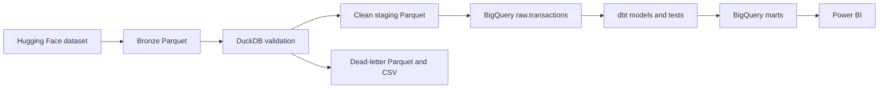

# Historical Retail Payments Analytics

A batch analytics project for exploring channel, geographic, merchant-category, customer-segment, and fraud-label patterns in a historical Nigerian retail transaction dataset. The source dataset is synthetic; this project does not support cross-bank comparisons or claims about live banking activity.

The pipeline downloads a Hugging Face Parquet dataset, validates it locally with DuckDB, loads accepted rows into BigQuery, and transforms it with dbt. The mart tables are available for Power BI through BigQuery's connector.

## What the data shows

The local validation run processed 5,000,000 rows: 4,421,296 accepted and 578,704 rejected (11.6%). These are recorded project results, not a promise that every source revision will produce the same counts.

| Rejection reason | Rows flagged |
| ---------------- | -----------: |
| Invalid state    |      542,759 |
| Invalid status   |       40,383 |
| Both reasons     |        4,438 |

Reason counts overlap. The state rule currently rejects the value `Abuja (FCT)` because the allowlist contains `fct`; the status rule rejects `pending`, while the configured allowed statuses are `success`, `failed`, and `reversed`. No rows in this run were rejected for negative balances. See [validation results and source fields](docs/data_dictionary.md).

## Architecture



The Python CLI runs download, validation, BigQuery load, and `dbt build` in sequence. It writes a JSON manifest for success or failure. For implementation details, see [architecture](docs/architecture.md) and [dbt models](docs/dbt_models.md).

## Quickstart

Requirements: Python 3.11 or later, Google Cloud access to BigQuery, and Application Default Credentials. The dbt profile uses OAuth.

```powershell
python -m venv .venv
.\.venv\Scripts\Activate.ps1
python -m pip install -e ".[dev]"
Copy-Item .env.example .env
```

Set `GCP_PROJECT_ID` in `.env`, then authenticate:

```powershell
gcloud auth application-default login
```

Run the complete pipeline:

```powershell
pipeline
```

The CLI also supports `pipeline --skip-download` when `data/bronze/transactions.parquet` already exists, and `pipeline --skip-dbt` to stop after loading BigQuery. Loading uses `WRITE_TRUNCATE` on the configured raw table; it replaces that table's contents.

For standalone dbt commands, set the environment needed by `dbt/profiles.yml` and point dbt at that profile:

```powershell
$env:GCP_PROJECT_ID = "your-gcp-project-id"
$env:BQ_DATASET_RAW = "raw"
$env:BQ_LOCATION = "US"
$env:DBT_PROFILES_DIR = "dbt"
dbt debug --project-dir dbt --profiles-dir dbt
dbt compile --project-dir dbt --profiles-dir dbt
dbt run --project-dir dbt --profiles-dir dbt
dbt test --project-dir dbt --profiles-dir dbt
```

Configuration variables are listed in [.env.example](.env.example). `BQ_DATASET_RAW` defaults to `raw`, `BQ_LOCATION` to `US`, and `DATA_DIR` to `data`. The dbt profile reads `GCP_PROJECT_ID`, `BQ_DATASET_RAW`, and `BQ_LOCATION` from the environment.

## Power BI

In Power BI Desktop, choose **Get data → Google BigQuery**, authenticate with a Google account that can read the BigQuery datasets and run query jobs, then select project `GCP_PROJECT_ID` and dataset `marts`. The mart dataset contains `dim_customer`, `dim_date`, `fct_channel_summary`, `fct_daily_summary`, `fct_fraud_summary`, `fct_geographic_summary`, `fct_merchant_summary`, `fct_transactions`, and `mart_executive_kpis`. The `staging` and `intermediate` datasets expose the other dbt model relations.

The dbt schema-name macro uses configured model schemas without adding the profile dataset prefix: outputs go to `staging`, `intermediate`, `marts`, and `snapshots`; the raw source remains in `raw`. The previous `raw_staging`, `raw_intermediate`, and `raw_marts` datasets were removed after confirming they contained only the old dbt relations.

## Project status and limitations

- The dataset is described by its publisher as synthetic and contains no bank identifier. It cannot support Tier 1/Tier 2 comparisons or cross-bank fraud tracking.
- The recorded rejection rate is high. Most rejected rows use `Abuja (FCT)`, which does not match the current state allowlist; `pending` is also excluded by the current status allowlist. Review these rules before interpreting the accepted subset as representative.
- The Parquet timestamp column has no timezone metadata. Its stored values span 2023-01-01 to 2024-12-30; the data does not establish whether they represent UTC or WAT. The pipeline currently applies no timezone shift.
- `snapshot_customers` references `customer_name`, which is absent from the raw loader schema and staging model. The snapshot needs correction before it can be relied on.
- A prior test run had 59 tests: 57 passed, the date-dimension test was subsequently fixed, and `assert_balance_consistency` returned 317,697 rows. The current project declares 90 tests; that full suite has not been rerun as a whole.
- The latest `dbt run` successfully built all 12 models into the unprefixed datasets. This does not establish that the full `dbt build` (including snapshots and tests) is clean.
- No Power BI screenshots or shared report URL are included yet.
- The upstream dataset card lists Apache-2.0 for the dataset. This repository has no `LICENSE` file; the dataset license does not automatically license this project's code.

## Repository map

- `pipeline/`: Typer CLI, download, DuckDB validation, BigQuery load, logging, and run manifests.
- `dbt/models/`: staging, intermediate, and mart SQL models plus model tests.
- `dbt/tests/`: singular SQL data tests.
- `dbt/analyses/`: ad hoc SQL analyses.
- `dbt/snapshots/`: customer snapshot configuration.
- `docs/`: architecture, model reference, and source/validation details.
- `data/`, `credentials/`, `.env`: local data and credentials; keep these out of version control.

## References

- [Source dataset](https://huggingface.co/datasets/electricsheepafrica/nigerian-banking-retail-transactions)
- [Architecture](docs/architecture.md)
- [dbt model reference](docs/dbt_models.md)
- [Data dictionary and validation results](docs/data_dictionary.md)
