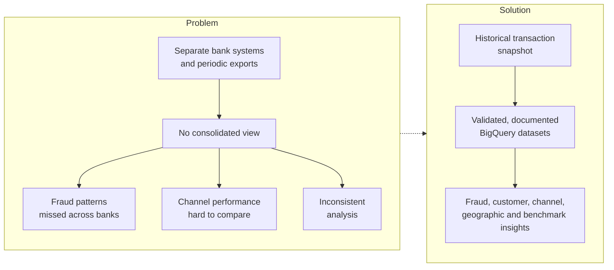

# End-to-End Data Engineering of a Banking Retail Payments Analytics

A batch data pipeline and analytics model for historical Nigerian retail banking transactions. Raw records are downloaded from Hugging Face, validated locally with DuckDB, loaded into Google BigQuery, and transformed with dbt into a star schema.

## Navigation

---

- [Overview](#overview)
- [The Business Problem](#the-business-problem)
- [Pipeline Overview](#pipeline-overview)
- [What the data shows](#what-the-data-shows)
- [Source Dataset](#source-dataset)
- [Architecture Flow](#architecture-flow)
- [Project Structure](#project-structure)
- [Technologies](#technologies)
- [Setup Instructions](#setup-instructions)
- [How It Works](#how-it-works)
- [Project status and limitations](#project-status-and-limitations)
- [Repository map](#repository-map)
- [References](#references)

---

## Overview

---

This project implements an end-to-end batch pipeline over 5,000,000 historical retail banking transactions. It covers ingestion, schema and business-rule validation, warehouse loading, and dimensional modelling.

The pipeline is a single command, `pipeline`, that runs every stage in order and writes a JSON run manifest on each execution, whether it succeeds or fails. Rejected records are kept in a dead-letter file, so no row is silently dropped.

Key outcomes from the most recent full run:

| Metric                      | Value                          |
| --------------------------- | ------------------------------ |
| Source rows                 | 5,000,000                      |
| Rejected rows (dead-letter) | 0                              |
| Warehouse                   | `raw.transactions` in BigQuery |

[](https://www.python.org/)
[](https://www.getdbt.com/)
[](https://duckdb.org/)
[](https://cloud.google.com/bigquery)
[](LICENSE)

---

## The Business Problem

> Each participating bank ran its own systems and periodic exports, so no one had a consolidated, trusted view of payment activity across the consortium.

| Gap                    | What was missing                                                       | Impact                                                                |
| ---------------------- | ---------------------------------------------------------------------- | --------------------------------------------------------------------- |
| **Fraud analysis**     | A cross-institution view of historical fraud patterns                  | A pattern visible at one bank could go unnoticed by the others        |
| **Channel visibility** | A connected view across Mobile, POS, ATM, Web, USSD, Agent, and Branch | Adoption and performance were hard to compare                         |
| **Decision-making**    | A governed, reusable data foundation                                   | Each analysis was rebuilt from raw exports, so results could conflict |



## Pipeline Overview

The pipeline runs as a single, auditable batch workflow:

1. **Download:** Fetch the pinned Hugging Face dataset revision and write an immutable Bronze Parquet snapshot.
2. **Validate:** Use DuckDB to check the schema, business rules, and duplicate transaction IDs.
3. **Split:** Write valid records to clean staging Parquet. Any future rejected records are written to the dead-letter outputs with error reasons.
4. **Load:** Replace `raw.transactions` in BigQuery and verify the loaded row count.
5. **Transform and test:** Run dbt staging, intermediate, mart, snapshot, and test resources.
6. **Record:** Write a JSON manifest containing source, validation, load, dbt, and reconciliation results.

## What the data shows

The source is a 5,000,000-row transaction dataset. Each row represents one synthetic retail-banking transaction and contains 16 source columns.

| Dataset area    | Columns                                                 | Description                                                  |
| --------------- | ------------------------------------------------------- | ------------------------------------------------------------ |
| Identifiers     | `transaction_id`, `account_id`, `customer_id`           | Transaction, account, and customer keys                      |
| Transaction     | `timestamp`, `amount_ngn`, `transaction_type`, `status` | When the transaction occurred, its amount, type, and outcome |
| Balances        | `balance_before_ngn`, `balance_after_ngn`               | Account balances before and after the transaction            |
| Merchant        | `merchant_category_code`, `merchant_name`               | Merchant classification and name                             |
| Geography       | `location_lga`, `location_state`                        | Local government area and state/FCT                          |
| Access and risk | `channel`, `device_id`, `fraud_flag`                    | Transaction channel, device, and fraud indicator             |

The latest local validation accepted all 5,000,000 rows, with no rejected records. The table above summarizes the source structure used by the loader.

## Source Dataset

The source is the synthetic [`electricsheepafrica/nigerian-banking-retail-transactions`](https://huggingface.co/datasets/electricsheepafrica/nigerian-banking-retail-transactions) dataset on Hugging Face. It contains one `train` split with 5,000,000 retail-banking transactions and 16 source columns.

The downloader uses `HF_DATASET_REVISION` from `.env` and defaults to a pinned dataset revision. The downloaded data is stored locally as Snappy-compressed Parquet under `data/bronze/`, which is intentionally excluded from version control.

## Architecture Flow



The Python CLI runs download, validation, BigQuery load, and `dbt build` in sequence. It writes a JSON manifest for success or failure. For implementation details, see [architecture](docs/architecture.md) and [dbt models](docs/dbt_models.md).

## Project Structure

```text
.
├── .github/
│   └── workflows/
│       └── ci.yml                         Automated lint, format, and test checks
├── .vscode/
│   ├── extensions.json                     Recommended Python and Ruff extensions
│   ├── launch.json                         Python pipeline debug configuration
│   ├── settings.json                       Python and pytest editor settings
│   └── tasks.json                          Test, lint, and pipeline tasks
├── dbt/
│   ├── analyses/
│   │   ├── analyze_customer_segment_value.sql
│   │   ├── analyze_daily_volume_trend.sql
│   │   └── analyze_fraud_by_channel.sql
│   ├── macros/
│   │   ├── generate_schema_name.sql        Routes models to BigQuery datasets
│   │   └── test_state_in_seed.sql          Seed-backed validation macro
│   ├── models/
│   │   ├── staging/
│   │   │   ├── properties.yml
│   │   │   ├── sources.yml
│   │   │   └── stg_transactions.sql        Clean source view
│   │   ├── intermediate/
│   │   │   ├── int_customer_metrics.sql
│   │   │   ├── int_transactions_enriched.sql
│   │   │   └── properties.yml
│   │   └── marts/
│   │       ├── dim_channel.sql
│   │       ├── dim_customer.sql
│   │       ├── dim_date.sql
│   │       ├── dim_geography.sql
│   │       ├── dim_merchants.sql
│   │       ├── dimensions.yml
│   │       ├── fct_channel_summary.sql
│   │       ├── fct_daily_summary.sql
│   │       ├── fct_fraud_summary.sql
│   │       ├── fct_geographic_summary.sql
│   │       ├── fct_merchant_summary.sql
│   │       ├── fct_transactions.sql
│   │       ├── fct_transactions_keys.sql
│   │       ├── mart_executive_kpis.sql
│   │       └── properties.yml
│   ├── seeds/
│   │   └── state_zones.csv                  State reference data
│   ├── snapshots/
│   │   └── snapshot_customers.sql           Customer-state history
│   ├── tests/
│   │   ├── assert_amounts_positive.sql
│   │   ├── assert_balance_consistency.sql
│   │   ├── assert_channel_summary_valid.sql
│   │   ├── assert_customer_status_totals.sql
│   │   ├── assert_date_dimension_complete.sql
│   │   ├── assert_executive_kpis_valid.sql
│   │   ├── assert_fact_keys_not_null.sql
│   │   ├── assert_fraud_summary_valid.sql
│   │   ├── assert_geographic_coverage.sql
│   │   ├── assert_geographic_summary_valid.sql
│   │   └── assert_no_future_or_past_dates.sql
│   ├── .gitignore
│   ├── .sqlfluff
│   ├── .sqlfluffgitignore
│   ├── .user.yml
│   ├── dbt_project.yml
│   ├── profiles.yml
│   └── README.md
├── docs/
│   ├── images/
│   │   ├── architecture.png
│   │   ├── architecture.svg
│   │   └── dbt-dag.png
│   ├── architecture.md                      Architecture decisions and data flow
│   └── dbt_models.md                        dbt model reference and test notes
├── pipeline/
│   ├── __init__.py
│   ├── config.py                            Paths, environment, and validation rules
│   ├── downloader.py                        Hugging Face download and Bronze snapshot
│   ├── loader.py                            BigQuery loader and row-count verification
│   ├── logger.py                            Console and rotating file logging
│   ├── manifests.py                         JSON run manifests and reconciliation
│   ├── run.py                               CLI orchestration
│   └── validator.py                         DuckDB schema, rule, and duplicate checks
├── tests/
│   ├── test_config.py
│   ├── test_downloader.py
│   ├── test_loader.py
│   ├── test_manifests.py
│   └── test_validator.py
├── .env.example                             Required local configuration template
├── .gitignore                               Tracked and generated-file exclusions
├── LICENSE                                  MIT license for this project’s code
├── Makefile                                 Common install, test, lint, and run commands
├── Readme.md                                Project overview and operating guide
├── pyproject.toml                           Package and tool configuration
└── requirements.txt                         Compatibility install entry point
```

Runtime data is kept outside version control in `data/`: Bronze input, clean staging, dead-letter outputs, logs, and run manifests. Local credentials and configuration live in `credentials/` and `.env`; both are intentionally ignored by Git.

## Technologies

| Area                       | Tools                                   |
| -------------------------- | --------------------------------------- |
| Language and CLI           | Python 3.11+, Typer                     |
| Source and storage formats | Hugging Face Datasets, PyArrow, Parquet |
| Local validation           | DuckDB                                  |
| Warehouse                  | Google BigQuery                         |
| Transformation             | dbt Core with the BigQuery adapter      |
| Quality and automation     | Pytest, Ruff, GitHub Actions            |

## Setup Instructions

Requirements: Python 3.11 or later, Google Cloud access to BigQuery, and Application Default Credentials. The dbt profile uses OAuth.

```powershell
python -m venv .venv
.\.venv\Scripts\Activate.ps1
python -m pip install -e ".[dev]"
Copy-Item .env.example .env
```

Set `GCP_PROJECT_ID` in `.env`, confirm the pinned `HF_DATASET_REVISION`, then authenticate:

```powershell
gcloud auth application-default login
```

## How It Works

Run the complete pipeline:

```powershell
pipeline
```

The CLI also supports `pipeline --skip-download` when `data/bronze/transactions.parquet` already exists, and `pipeline --skip-dbt` to stop after loading BigQuery. Loading uses `WRITE_TRUNCATE` on the configured raw table; it replaces that table's contents.

For standalone dbt commands, set the environment needed by `dbt/profiles.yml` and point dbt at that profile:

```powershell
$env:GCP_PROJECT_ID = "your-gcp-project-id"
$env:BQ_DATASET_RAW = "raw"
$env:BQ_LOCATION = "US"
$env:DBT_PROFILES_DIR = "dbt"
dbt debug --project-dir dbt --profiles-dir dbt
dbt compile --project-dir dbt --profiles-dir dbt
dbt run --project-dir dbt --profiles-dir dbt
dbt test --project-dir dbt --profiles-dir dbt
```

Configuration variables are listed in [.env.example](.env.example). `HF_DATASET_REVISION` pins the Hugging Face source revision, `BQ_DATASET_RAW` defaults to `raw`, `BQ_LOCATION` to `US`, and `DATA_DIR` to `data`. The dbt profile reads `GCP_PROJECT_ID`, `BQ_DATASET_RAW`, and `BQ_LOCATION` from the environment.

The dbt schema-name macro uses configured model schemas without adding the profile dataset prefix: outputs go to `staging`, `intermediate`, `marts`, and `snapshots`; the raw source remains in `raw`. The previous `raw_staging`, `raw_intermediate`, and `raw_marts` datasets were removed after confirming they contained only the old dbt relations.

## Project status and limitations

- The dataset is described by its publisher as synthetic and contains no bank identifier. It cannot support Tier 1/Tier 2 comparisons or cross-bank fraud tracking.
- No rows were rejected in the recorded local validation run. Review validation counts in the run manifest when the source data or validation rules change.
- The Parquet timestamp column has no timezone metadata. Its stored values span 2023-01-01 to 2024-12-30; the data does not establish whether they represent UTC or WAT. The pipeline currently applies no timezone shift.
- The Python unit suite currently has 10 tests. dbt declares schema tests and 11 singular SQL tests, which require a BigQuery connection; the full dbt build has not been rerun as a whole.
- The latest `dbt run` successfully built all 12 models into the unprefixed datasets. This does not establish that the full `dbt build` (including snapshots and tests) is clean.
- The upstream dataset card lists Apache-2.0 for the dataset. That license applies to the source dataset; this project's code is licensed separately under the MIT License.

## Repository map

- `pipeline/`: Typer CLI, download, DuckDB validation, BigQuery load, logging, and run manifests.
- `dbt/models/`: staging, intermediate, and mart SQL models plus model tests.
- `dbt/tests/`: singular SQL data tests.
- `dbt/analyses/`: ad hoc SQL analyses.
- `dbt/snapshots/`: customer snapshot configuration.
- `docs/`: architecture and dbt model reference.
- `data/`, `credentials/`, `.env`: local data and credentials; keep these out of version control.

## References

- [Source dataset](https://huggingface.co/datasets/electricsheepafrica/nigerian-banking-retail-transactions)
- [Architecture](docs/architecture.md)
- [dbt model reference](docs/dbt_models.md)
