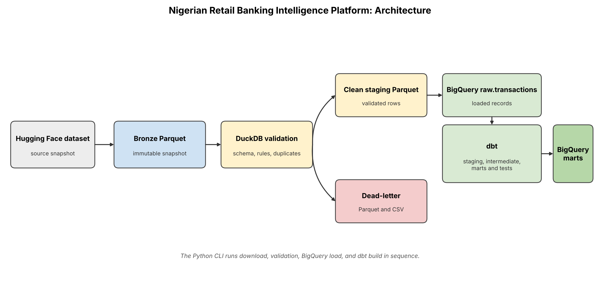
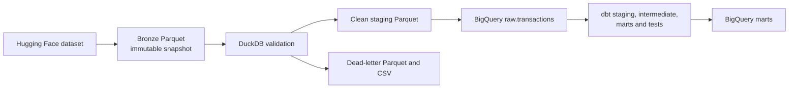

# Architecture Decisions

This document explains the architecture of the Nigerian Retail Banking Intelligence Platform and the reasoning behind each major decision. The high-level diagram is in the [README](../README.md#architecture). This document covers the _why_.

## Contents

1. [System overview](#1-system-overview)
2. [Decision log](#2-decision-log)
3. [Component decisions](#3-component-decisions)
4. [Data flow and layers](#4-data-flow-and-layers)
5. [Quality, reproducibility, and failure handling](#5-quality-reproducibility-and-failure-handling)
6. [Trade-offs and rejected alternatives](#6-trade-offs-and-rejected-alternatives)
7. [Known limitations](#7-known-limitations)
8. [Future evolution](#8-future-evolution)

---

## 1. System overview

([SVG source](images/architecture.svg))

The platform is a batch pipeline that turns one historical transaction snapshot into validated, documented analytical datasets in BigQuery. It runs on demand through a single command. The design follows one principle: **validate locally and cheaply, then transform and serve in the cloud.**

---

## 2. Decision log

| ID  | Decision                                                       | Status   |
| --- | -------------------------------------------------------------- | -------- |
| D1  | Batch execution on demand, no scheduler                        | Accepted |
| D2  | Validate with DuckDB locally before any cloud load             | Accepted |
| D3  | Keep the source snapshot as an immutable Bronze file           | Accepted |
| D4  | Route rejected rows to a local dead-letter output              | Accepted |
| D5  | Use BigQuery as the cloud warehouse                            | Accepted |
| D6  | Run all transformations and tests in dbt on BigQuery           | Accepted |
| D7  | Use layered models: raw, staging, intermediate, marts          | Accepted |
| D8  | Use Parquet as the interchange format                          | Accepted |
| D9  | Use a Python CLI with a Make target as the entry point         | Accepted |
| D10 | Write a run manifest for every run, success or failure         | Accepted |
| D11 | Make runs idempotent for the same source version               | Accepted |
| D12 | Keep the platform out of scope for dashboards in this document | Accepted |

---

## 3. Component decisions

### D1. Batch execution on demand, no scheduler

**Decision:** The pipeline runs through one explicit command (`make pipeline` or `python -m pipeline.run`). It has no scheduler, retry policy, or backfill logic.

**Why:**

- The source is a single, finite historical snapshot of about 5 million records. It does not arrive on a schedule.
- The dependency chain is linear: download, validate, load, transform, test. There is nothing to parallelise across independent jobs.
- A scheduler adds operational surface (a server or managed service, DAG maintenance, alert policies) that gives no benefit for a one-off dataset.

**Consequence:** Re-running the pipeline is a deliberate human action. This is acceptable for a bounded dataset. It would not be acceptable for a recurring feed (see D1 revisit conditions in [section 8](#8-future-evolution)).

---

### D2. Validate with DuckDB locally before any cloud load

**Decision:** DuckDB reads the Bronze Parquet file locally and runs schema checks, business-rule checks, and duplicate detection before anything is loaded into BigQuery.

**Why:**

- **Cost:** Validation on a local engine costs nothing. Scanning a 5-million-row file in BigQuery for checks that could run locally would consume query budget for no gain.
- **Speed:** DuckDB processes a Parquet file of this size quickly on a single machine, with no cluster or warehouse to start.
- **Gatekeeping:** Only records that pass validation reach the warehouse. BigQuery stays a place for trusted data, not for raw problems to be discovered later.
- **No production data in DuckDB:** DuckDB is a scratchpad. It holds no state that other systems depend on, so it can be deleted and rebuilt at any time.

**Consequence:** Validation logic lives in Python and SQL run by DuckDB, separate from the dbt tests in BigQuery. The two layers overlap on some rules on purpose: DuckDB protects the load, dbt protects the models.

---

### D3. Keep the source snapshot as an immutable Bronze file

**Decision:** The downloaded Parquet file is written once to a Bronze location and never modified. Its checksum is recorded in the run manifest.

**Why:**

- **Traceability:** Any output can be traced back to the exact bytes that produced it.
- **Repeatability:** If validation rules change, the pipeline can be re-run against the same input.
- **Independence from the source:** If the upstream dataset is updated or removed, the local copy remains.

**Consequence:** Bronze files use local disk space proportional to the dataset size. They are not committed to Git.

---

### D4. Route rejected rows to a local dead-letter output

**Decision:** Rows that fail validation are written to a dead-letter location as Parquet and CSV, each with an error reason. The run continues only if the rules allow it (see D12 in the decision log and [section 5](#5-quality-reproducibility-and-failure-handling)).

**Why:**

- **Nothing is silently dropped.** Every rejected row can be inspected and counted.
- **Parquet for machines, CSV for people:** Parquet keeps types intact for reprocessing. CSV opens in any spreadsheet tool for a quick look.
- **Auditability:** Row counts in the manifest reconcile with Bronze, clean, and dead-letter outputs.

**Consequence:** Dead-letter files can grow large if validation rules are too strict. Monitoring the rejection rate in the manifest catches this early.

---

### D5. Use BigQuery as the cloud warehouse

**Decision:** BigQuery holds all production data: the raw load, staging, intermediate, and marts datasets.

**Why:**

- **Managed and serverless:** No cluster to size, patch, or maintain.
- **Native Looker Studio connection:** Downstream analytics connect directly without an extra export step.
- **Free tier fits the workload:** At this data volume, storage and query costs remain within the free tier.
- **Standard SQL and dbt support:** The dbt BigQuery adapter is mature and widely used.

**Consequence:** The platform depends on Google Cloud. Moving to another warehouse would require changing the load step and the dbt adapter. The dbt models themselves would mostly carry over.

---

### D6. Run all transformations and tests in dbt on BigQuery

**Decision:** dbt builds every transformation layer inside BigQuery. The local pipeline does not transform data beyond validation.

**Why:**

- **One place for business logic:** Transformations are version-controlled SQL in dbt, not Python scripts scattered across the pipeline.
- **Compute stays where the data is:** BigQuery runs the transformations, so the data does not move back and forth.
- **Production practice:** Teams commonly use this split, with validation at the edge and transformation in the warehouse.
- **Tests live with models:** dbt tests sit next to the models they check and run in the same `dbt build` step.

**Consequence:** Developing transformations requires a BigQuery connection, not only a local environment. Sample data or a dev dataset can reduce cost during development.

---

### D7. Use layered models: raw, staging, intermediate, marts

**Decision:** Data moves through four layers, each with one job.

| Layer        | Dataset              | Job                                                               |
| ------------ | -------------------- | ----------------------------------------------------------------- |
| Raw          | `raw.transactions`   | Validated records as loaded. No changes.                          |
| Staging      | `staging` (dbt)      | Rename, cast, and standardise fields. One model per source table. |
| Intermediate | `intermediate` (dbt) | Enrich with time, channel, fraud, and balance-change logic.       |
| Marts        | `marts` (dbt)        | Aggregates shaped for each analytical use case.                   |

**Why:**

- **Separation of concerns:** Cleaning, business logic, and presentation are kept apart, so a change in one does not force changes in the others.
- **Easier debugging:** A wrong number in a mart can be traced back layer by layer.
- **Reuse:** Intermediate models can feed several marts without repeating logic.
- **Stable interface for consumers:** Marts are the only layer analysts query. Internal logic can change without breaking dashboards.

**Consequence:** More models to maintain. For a project this size, the cost is small and the clarity is worth it.

---

### D8. Use Parquet as the interchange format

**Decision:** Bronze, clean staging, and dead-letter data are stored as Parquet. CSV is used only for dead-letter files meant for human review.

**Why:**

- **Typed and columnar:** Column types survive the handoff between DuckDB and BigQuery. Column-level reads are efficient.
- **Compressed:** Parquet is much smaller than CSV for a dataset of this size.
- **Native support:** DuckDB reads and writes Parquet directly, and BigQuery loads it natively.

**Consequence:** Parquet files are not readable in a spreadsheet. The CSV dead-letter output covers that need.

---

### D9. Use a Python CLI with a Make target as the entry point

**Decision:** One Python command (`python -m pipeline.run`) runs the full sequence, and a `make pipeline` target wraps it.

**Why:**

- **One entry point:** Anyone running the project uses the same command, which reduces mistakes.
- **Python for orchestration:** Python handles HTTP download, file handling, DuckDB, the BigQuery client, and subprocess calls to dbt in one language.
- **Make for convenience:** Make is available on most developer machines and documents the common commands in one file.

**Consequence:** The pipeline stops at the first failing step and writes the failure to the manifest. Steps are not retried automatically.

---

### D10. Write a run manifest for every run

**Decision:** Every run writes a JSON manifest that records the source fingerprint, row counts, validation results, dbt test outcome, output locations, timestamps, and final status. This applies to both successful and failed runs.

**Why:**

- **Auditability:** A reviewer can see what a run did without reading logs.
- **Reproducibility:** The manifest records the inputs needed to repeat a run.
- **Failure investigation:** A failed run still produces a manifest showing where it stopped.

**Consequence:** Manifests accumulate over time. They are small and can be kept indefinitely.

---

### D11. Make runs idempotent for the same source version

**Decision:** Re-running the pipeline with the same source version produces the same outputs.

**Why:**

- **Safe re-runs:** An operator who is unsure whether a run completed can run it again without creating duplicates.
- **Testable:** Idempotency makes it possible to confirm that changes do not alter results unexpectedly.

**Consequence:** Load and dbt steps must overwrite or replace their targets rather than append to them. The exact mechanism (for example, `WRITE_TRUNCATE` on load and `dbt build` table materialisation) should be documented in the pipeline code.

---

### D12. Scope: dashboards are outside this architecture

**Decision:** The architecture ends at the BigQuery marts. Dashboard design and Looker Studio configuration are documented separately.

**Why:**

- The architecture's job is to produce trusted datasets. Dashboards are a consumer of those datasets.
- Keeping the boundary clear means dashboard changes do not require architecture changes.

**Consequence:** Anyone reading only this document will not see how the data is used. The README links to the dashboard documentation for that.

---

## 4. Data flow and layers

1. **Download:** The Python CLI fetches the pinned version of the dataset from Hugging Face and records its checksum.
2. **Bronze:** The file is written once as an immutable Parquet snapshot.
3. **Validate:** DuckDB checks schema, business rules, and transaction ID uniqueness.
4. **Split:** Passing rows go to the clean staging Parquet. Failing rows go to the dead-letter output with error reasons.
5. **Load:** Clean records are loaded into `raw.transactions` in BigQuery.
6. **Transform:** `dbt build` runs the staging, intermediate, and mart models, then the tests.
7. **Record:** The manifest is written with the final status.

---

## 5. Quality, reproducibility, and failure handling

**Two layers of checks.** DuckDB checks run before load and protect the warehouse. dbt tests run after transformation and protect the models. Each catches a different class of problem.

| Check            | Where  | Examples                                    |
| ---------------- | ------ | ------------------------------------------- |
| Schema and types | DuckDB | Required fields present, correct data types |
| Business rules   | DuckDB | Valid amounts, dates, states, and channels  |
| Duplicates       | DuckDB | Unique transaction ID                       |
| Key constraints  | dbt    | Unique and non-null transaction IDs         |
| Accepted values  | dbt    | Channel values in the accepted list         |
| Logic            | dbt    | Valid dates, non-negative metrics           |

**Failure behaviour.** A failed step stops the run. The Bronze file, dead-letter output, and partial manifest are kept for investigation. Nothing is deleted on failure.

**Reproducibility.** The Bronze checksum, pinned dataset version, and manifest together identify exactly what a run produced.

---

## 6. Trade-offs and rejected alternatives

| Alternative                     | Why it was not chosen                                                                                               |
| ------------------------------- | ------------------------------------------------------------------------------------------------------------------- |
| Airflow or another orchestrator | Adds operational overhead for a one-off dataset with a linear chain. Revisit when the source becomes recurring.     |
| Validate in BigQuery only       | Costs query budget for checks that run for free locally, and lets bad rows reach the warehouse before being caught. |
| Pandas instead of DuckDB        | Slower and more memory-hungry on a file of this size. DuckDB queries Parquet directly.                              |
| Spark or Dataproc               | A distributed engine is unnecessary at 5 million rows and adds cluster management.                                  |
| Transformations in Python       | Harder to test, version, and document than dbt models.                                                              |
| Loading CSV instead of Parquet  | Loses types and is larger and slower to load.                                                                       |
| Snowflake or Power BI           | Not part of the chosen stack. The project uses BigQuery and Looker Studio.                                          |

---

## 7. Known limitations

- **Synthetic data.** The source is synthetic. Findings describe the dataset, not real banking behaviour.
- **Batch only.** The design does not handle streaming or frequent updates.
- **No partitioning or clustering yet.** BigQuery tables are not partitioned or clustered. This is acceptable at current volume and can be added through dbt configs.
- **Manual re-runs.** Retries and backfills are not automated.
- **Single-machine validation.** DuckDB runs on one machine. This is fine for this volume and would need revisiting at much larger scale.

---

## 8. Future evolution

**Revisit D1 (scheduler) when:**

- the platform receives scheduled source files,
- it coordinates multiple upstream systems,
- retry and alert policies become necessary, or
- backfills or independently scheduled maintenance are required.

At that point, an orchestrator such as Apache Airflow fits the design without changing the layers.

**Revisit partitioning and clustering when:** tables grow large enough that query cost or speed becomes a concern. Both are configured in dbt and do not change the architecture.

---

_Last updated: [date]. Update this document when a decision in the log changes._
