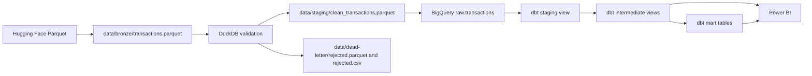

# Architecture

## Active pipeline

The repository runs a local-to-cloud batch workflow. It uses DuckDB for pre-load validation and BigQuery for storage and dbt transformations.

## Pipeline stages

1. **Download**: `pipeline/downloader.py` reads `electricsheepafrica/nigerian-banking-retail-transactions` with Hugging Face `datasets` and writes Snappy-compressed Parquet. It retries up to three times, waiting five seconds between failed attempts. It uses the `train` split when available; otherwise it concatenates splits.
2. **Validate**: `pipeline/validator.py` checks required columns and business rules in DuckDB. Accepted rows are written to clean staging Parquet; rejected rows include `error_reasons` and are written to Parquet and CSV.
3. **Load**: `pipeline/loader.py` loads the clean Parquet into `{GCP_PROJECT_ID}.{BQ_DATASET_RAW}.transactions`. The load uses `WRITE_TRUNCATE`, checks row counts, and removes the local clean file after a successful load.
4. **Transform**: `pipeline/run.py` invokes `dbt build --project-dir <repo>/dbt`. A failure at any stage is written to the run manifest and exits non-zero.

Run the pipeline with `pipeline`. `--skip-download` reuses the existing Bronze file; `--skip-dbt` stops after the BigQuery load. The pipeline still validates and loads when download or dbt is skipped.

## Storage and configuration

- Bronze: `data/bronze/transactions.parquet`
- Temporary clean load: `data/staging/clean_transactions.parquet`
- Rejected records: `data/dead-letter/rejected.parquet` and `rejected.csv`
- Run manifests: `data/manifests/run_*.json`
- Logs: `data/logs/pipeline_YYYY-MM-DD.log`
- BigQuery raw table: `{project}.{BQ_DATASET_RAW}.transactions`
- dbt's `generate_schema_name` macro uses configured custom schemas as-is: `staging`, `intermediate`, `marts`, and `snapshots`. The raw source stays in `raw`.
- Power BI can connect to the `marts` dataset; the mart relations are listed in [dbt_models.md](dbt_models.md).

`GCP_PROJECT_ID` is required. `BQ_DATASET_RAW` defaults to `raw`, `BQ_LOCATION` to `US`, and `DATA_DIR` to `data`. `.env` is loaded by the Python pipeline. Standalone dbt commands need these values in the process environment and should use `--profiles-dir dbt` to load the project's profile.

The previous `raw_staging`, `raw_intermediate`, and `raw_marts` datasets were removed after confirming they contained only the old dbt relations. The source dataset `raw` was retained.

## Audit and logging

Each pipeline attempt writes a JSON manifest with status, timestamps, duration, source/validation/load/dbt counts, a row-count reconciliation result, and failure details when applicable. Manifest writes use a temporary file followed by an atomic rename. Loguru writes INFO output to the console and DEBUG output to daily files with seven-day retention and ZIP compression.

## Current caveats

The source data is synthetic. The current allowlists reject the source value `Abuja (FCT)` and the status `pending`; recorded local results are detailed in [data_dictionary.md](data_dictionary.md). Parquet timestamps carry no timezone metadata, and the pipeline does not shift them. The customer snapshot references a `customer_name` field that is not present in the loader schema or staging model. The `dbt build` path therefore requires additional validation before it can be described as clean end to end.
