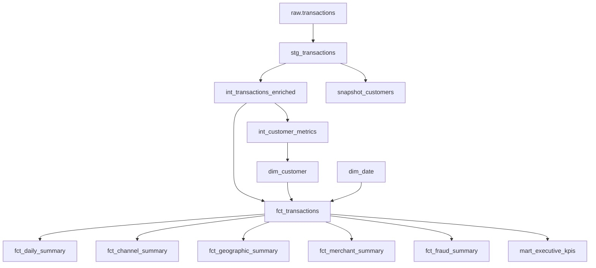

# dbt Model Reference

The dbt project is in `dbt/`, uses the `banking_platform` project name and the `dbt` profile, and targets BigQuery. It currently declares 12 models, 90 data tests, three analyses, and one snapshot.

The profile's base dataset defaults to `raw`. The project's `generate_schema_name` macro applies configured custom schemas as-is, so model outputs are in `staging`, `intermediate`, and `marts`; the source table remains `raw.transactions`. Power BI can browse the mart relations in the `marts` dataset.

## Lineage



## Models

| Model                       | Layer / grain                      | Purpose                                                                                                           |
| --------------------------- | ---------------------------------- | ----------------------------------------------------------------------------------------------------------------- |
| `stg_transactions`          | Staging / transaction              | Casts source fields, drops null transaction IDs, safely casts merchant category codes, and retains status.        |
| `int_transactions_enriched` | Intermediate / transaction         | Adds calendar fields, amount bands, balance change, normalized values, and status/type/fraud flags.               |
| `int_customer_metrics`      | Intermediate / customer            | Aggregates transaction counts and amounts, fraud counts, dates, preferred channel, and distinct states.           |
| `dim_date`                  | Mart / date                        | Calendar from 2023-01-01 through 2024-12-31, including weekday and fiscal quarter fields.                         |
| `dim_customer`              | Mart / customer                    | Customer hash key, totals, tenure, preferred channel, states, and value segment. The source has no customer name. |
| `fct_transactions`          | Mart / transaction                 | Enriched transactions joined to customer and date dimensions.                                                     |
| `fct_daily_summary`         | Mart / date, channel, type, status | Transaction and fraud counts, amount metrics, and fraud rate.                                                     |
| `fct_channel_summary`       | Mart / channel                     | Transaction, fraud, amount, debit/credit, customer/account counts, and ranks.                                     |
| `fct_geographic_summary`    | Mart / state                       | Transaction/fraud/amount metrics and distinct customer/account counts by state.                                   |
| `fct_merchant_summary`      | Mart / merchant category code      | Transaction and fraud metrics by non-null merchant category code.                                                 |
| `fct_fraud_summary`         | Mart / channel and state           | Fraud counts, rates, values, dates, and ranks by channel/state.                                                   |
| `mart_executive_kpis`       | Mart / one row                     | Platform-wide counts, values, rates, and latest-day metrics.                                                      |

The nine mart relations available in BigQuery's `marts` dataset are `dim_customer`, `dim_date`, `fct_channel_summary`, `fct_daily_summary`, `fct_fraud_summary`, `fct_geographic_summary`, `fct_merchant_summary`, `fct_transactions`, and `mart_executive_kpis`.

Customer segments use total transaction value: `high_value` at or above 1,000,000 NGN, `mid_value` at or above 100,000 NGN, otherwise `low_value`.

## Tests

Schema tests are declared in `models/staging/properties.yml`, `models/intermediate/properties.yml`, and `models/marts/properties.yml`. They include `unique`, `not_null`, `accepted_values`, and relationships. Eleven singular SQL tests cover positive amounts, balance consistency, date bounds, aggregate totals, key nulls, date completeness, geographic coverage, and summary sanity checks.

The project currently declares 90 tests in total. A previous full test run (59 tests at that point) passed 57; the date-dimension test was fixed afterward, while `assert_balance_consistency` returned 317,697 rows. The expanded 90-test suite has not been rerun as a whole.

## Snapshot caveat

`snapshot_customers` is configured as a check-strategy snapshot keyed by `customer_id`, checking `customer_name` and `location_state`. `customer_name` is absent from both the BigQuery raw loader schema and `stg_transactions`; the snapshot is not currently runnable without changing the snapshot definition or upstream model.

## Commands

```bash
dbt ls --project-dir dbt --resource-type model
dbt compile --project-dir dbt --profiles-dir dbt
dbt run --project-dir dbt --profiles-dir dbt
dbt test --project-dir dbt --profiles-dir dbt
dbt build --project-dir dbt --profiles-dir dbt
dbt snapshot --project-dir dbt --profiles-dir dbt
```

`dbt build` includes model builds, tests, and snapshots. Treat it as unverified until the snapshot mismatch is fixed and the full current test suite passes.
