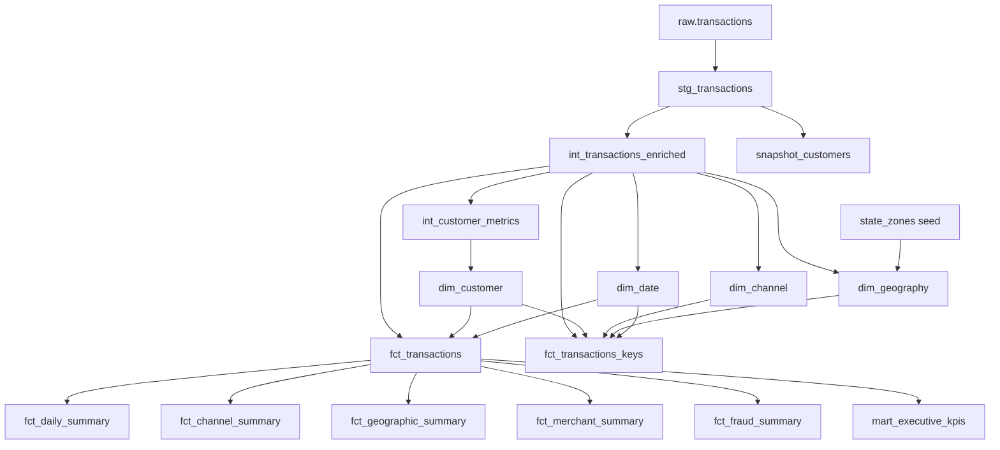

# dbt Model Reference

The dbt project is in `dbt/`, uses the `banking_platform` project name and the `dbt` profile, and targets BigQuery. The project contains 16 model SQL files: one staging model, two intermediate models, and 13 files under marts. `dim_merchants.sql` is currently empty, so it does not define a usable model; the other 15 files contain model SQL. The project also declares three analyses and one snapshot. Eleven singular SQL test files are present under `dbt/tests/`.

The profile's base dataset defaults to `raw`. The `generate_schema_name` macro applies configured custom schemas as-is, so model outputs are in `staging`, `intermediate`, and `marts`; the source table is `raw.transactions`. The mart dataset now includes customer, date, channel, and geography dimensions, transaction facts at both detailed and key-only grains, and summary models.

## Lineage



## Models

| Model | Layer / grain | Purpose |
| --- | --- | --- |
| `stg_transactions` | Staging / transaction | Casts and standardises raw fields, removes rows with null transaction IDs, safely casts merchant category codes, and retains transaction status. |
| `int_transactions_enriched` | Intermediate / transaction | Adds calendar fields, amount bands, balance change, normalized values, and status, type, and fraud flags. |
| `int_customer_metrics` | Intermediate / customer | Aggregates transaction counts and amounts, fraud counts, first and last transaction dates, preferred channel, and distinct states. |
| `dim_customer` | Mart / customer | Customer hash key, transaction totals, tenure, preferred channel, states, and value segment. The source has no customer name. |
| `dim_date` | Mart / date | Calendar from 2023-01-01 through 2024-12-31 with weekday and fiscal quarter fields. |
| `dim_channel` | Mart / channel | Hash key for each distinct, non-empty normalized transaction channel. |
| `dim_geography` | Mart / state and LGA | Hash key for each normalized state and LGA, with state aliases mapped through the `state_zones` seed and geopolitical zone. |
| `dim_merchants` | Mart / not defined | The file is empty and currently has no model query or defined grain. |
| `fct_transactions` | Mart / transaction | Enriched transaction records joined to customer and date dimensions. |
| `fct_transactions_keys` | Mart / transaction | Transaction ID and customer, channel, geography, and date dimension keys for a star-schema join path. |
| `fct_daily_summary` | Mart / date, channel, type, status | Transaction and fraud counts, amount metrics, and fraud rate. |
| `fct_channel_summary` | Mart / channel | Transaction, fraud, amount, debit/credit, customer/account counts, and ranks. |
| `fct_geographic_summary` | Mart / state | Transaction, fraud, and amount metrics plus distinct customer/account counts by state. |
| `fct_merchant_summary` | Mart / merchant category code | Transaction and fraud metrics by non-null merchant category code. |
| `fct_fraud_summary` | Mart / channel and state | Fraud counts, rates, values, dates, and ranks by channel and state. |
| `mart_executive_kpis` | Mart / one row | Platform-wide counts, values, rates, and latest-day metrics. |

The marts directory contains `dim_channel`, `dim_customer`, `dim_date`, `dim_geography`, `dim_merchants`, `fct_channel_summary`, `fct_daily_summary`, `fct_fraud_summary`, `fct_geographic_summary`, `fct_merchant_summary`, `fct_transactions`, `fct_transactions_keys`, and `mart_executive_kpis`. `dim_merchants.sql` is empty and should be treated as unfinished until it contains a query.

Customer segments use total transaction value: `high_value` at or above 1,000,000 NGN, `mid_value` at or above 100,000 NGN, otherwise `low_value`.

## Tests and snapshot

Schema tests are declared in `models/staging/sources.yml`, `models/staging/properties.yml`, `models/intermediate/properties.yml`, `models/marts/properties.yml`, and `models/marts/dimensions.yml`. They cover uniqueness, non-null values, accepted values, and relationships between transaction facts and dimensions. The seed-backed `state_in_seed` test is configured with warning severity. Eleven singular SQL tests cover positive amounts, balance consistency, date bounds and completeness, aggregate totals, fact keys, geographic coverage and summary validity, channel summary validity, fraud summary validity, and executive KPI validity.

The `snapshot_customers` check-strategy snapshot is keyed by `customer_id` and tracks changes to `location_state`. Its input is `stg_transactions`, which provides both fields. This reflects the current snapshot definition; it no longer depends on a `customer_name` field.

This reference describes the current project files. It does not assert that the full current test suite or `dbt build` has been run successfully.

## Commands

```bash
dbt ls --project-dir dbt --profiles-dir dbt --resource-type model
dbt compile --project-dir dbt --profiles-dir dbt
dbt run --project-dir dbt --profiles-dir dbt
dbt test --project-dir dbt --profiles-dir dbt
dbt build --project-dir dbt --profiles-dir dbt
dbt snapshot --project-dir dbt --profiles-dir dbt
```

`dbt build` builds selected resources and runs their tests. `dbt snapshot` can run the configured customer snapshot independently.
